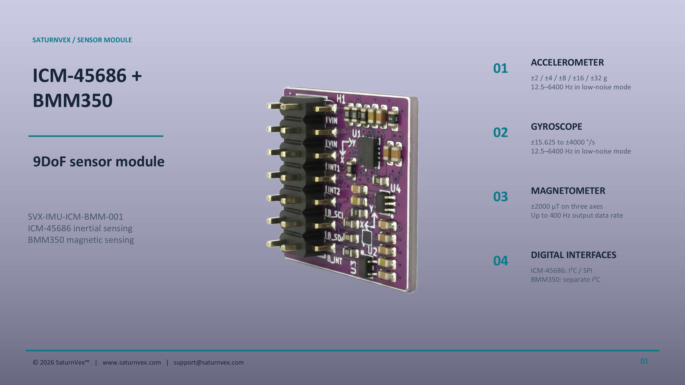
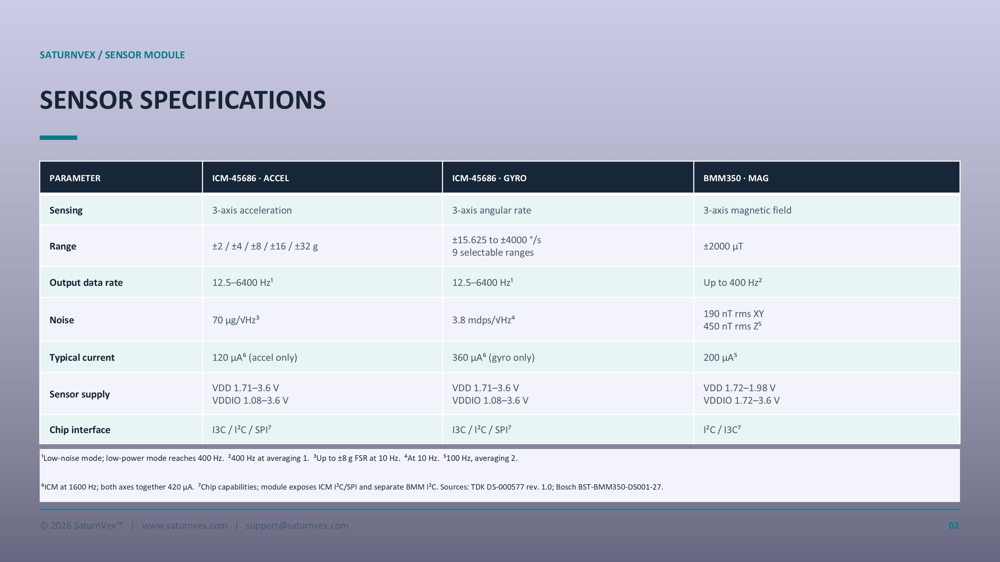
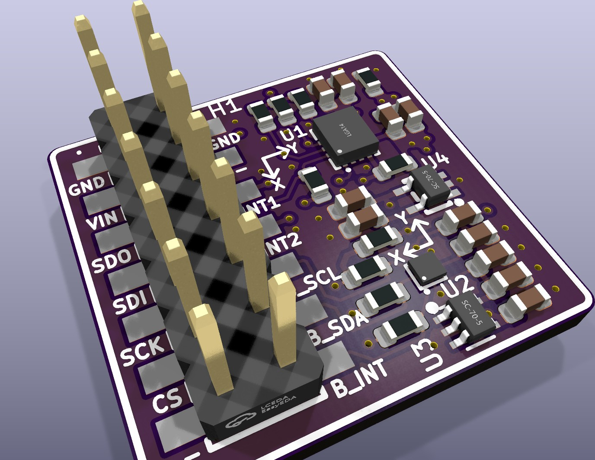
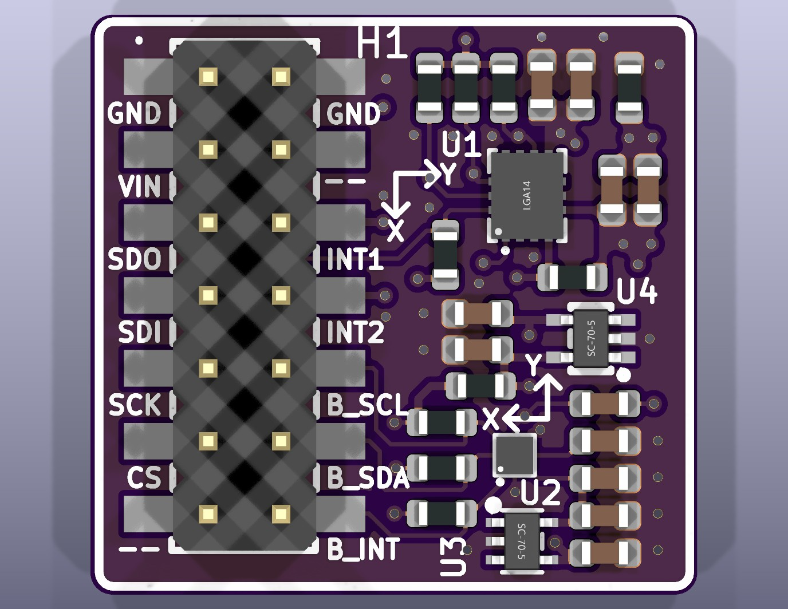

<strong>SATURNVEX · SENSOR MODULE</strong>

<!-- Product cover images; GitHub constrains content to the README panel width. -->

# SVX-IMU-ICM-BMM — ICM-45686 + BMM350 9DoF Sensor Module

*SaturnVex™ — embedded hardware, firmware and Edge AI platforms*

A compact 9DoF sensor module that combines the TDK InvenSense ICM-45686 six-axis IMU (accelerometer + gyroscope) with the Bosch BMM350 three-axis magnetometer. Both sensors are wired to one 2 × 7 pin header: the IMU on I²C or SPI with two interrupt lines, the magnetometer on its own I²C bus with an interrupt. The module has no microcontroller; the host reads the sensors and runs the attitude / heading fusion.

## Product specifications

| Item | Specification |
|---|---|
| Product code | `SVX-IMU-ICM-BMM-001` |
| IMU | TDK InvenSense ICM-45686: 3-axis accelerometer ±2 to ±32 g, 3-axis gyroscope ±15.625 to ±4000 °/s, 12.5–6400 Hz ODR (low-noise mode) |
| Magnetometer | Bosch BMM350: 3-axis, ±2000 µT, up to 400 Hz ODR |
| IMU interface | SPI (SCK, SDI, SDO, CS) or I²C (SCL, SDA; address 0x68 / 0x69 by SDO), INT1 and INT2 |
| Magnetometer interface | Separate I²C bus (address 0x14) with data-ready interrupt |
| Connector | H1, 2 × 7 pins, 2.54 mm: GND, VIN, IMU bus and interrupts, magnetometer bus and interrupt |
| Logic level | 3.3 V; pull-ups on all bus and interrupt lines |
| Power | VIN 3.3–5.5 VDC; onboard 3.3 V (TPS79733) and 1.8 V (TPS79718) regulators |
| Board dimensions | About 21 × 20 mm |
| Test projects provided | ICM-45686 SPI and BMM350 I²C examples with the SVX-MCU-STM32G474-001 as host |

Sensor figures are from the TDK ICM-45686 (DS-000577) and Bosch BMM350 (BST-BMM350-DS001) datasheets; see the second cover image for noise, current and supply details.

## Documentation

| Resource | File |
|---|---|
| **Getting started (power, interfaces, H1 pinout)** | [Open](docs/README.md) |
| **Test projects** | [Browse tests](tests/README.md) |
| **Mechanical CAD** | [CAD files / STEP](cad/README.md) |
| **Download all available documentation and CAD** | [Download complete package](downloads/SVX-IMU-ICM-BMM-001_Complete_Resources.zip) |

## Test projects — host code on SVX-MCU-STM32G474-001

| Test | Test guide (PDF) | Source (ZIP) | Overview |
|---|---|---|---|
| 01 — ICM-45686 IMU (SPI) | [Guide (STM32G474 Test 04)](https://github.com/SaturnVex/SVX-MCU-STM32G474-001/blob/main/tests/04-icm45686-spi3/SaturnVex_STM32G474_ICM45686_Test_Guide_EN.pdf) | [Source (STM32G474 Test 04)](https://github.com/SaturnVex/SVX-MCU-STM32G474-001/raw/main/tests/04-icm45686-spi3/STM32G474_ICM45686_SPI3_SaturnVex.zip) | [Open](tests/01-icm45686-spi/README.md) |
| 02 — BMM350 Magnetometer (I²C) | [Guide (STM32G474 Test 08)](https://github.com/SaturnVex/SVX-MCU-STM32G474-001/blob/main/tests/08-bmm350-i2c2/SaturnVex_STM32G474_BMM350_Test_Guide_EN.pdf) | [Source (STM32G474 Test 08)](https://github.com/SaturnVex/SVX-MCU-STM32G474-001/raw/main/tests/08-bmm350-i2c2/STM32G474_BMM350_I2C2_SaturnVex.zip) | [Open](tests/02-bmm350-i2c/README.md) |

**Getting started:** the communication code for both sensors is in the [SVX-MCU-STM32G474-001](https://github.com/SaturnVex/SVX-MCU-STM32G474-001) repository: the [ICM-45686 SPI3 example](https://github.com/SaturnVex/SVX-MCU-STM32G474-001/tree/main/tests/04-icm45686-spi3) and the [BMM350 I2C2 example](https://github.com/SaturnVex/SVX-MCU-STM32G474-001/tree/main/tests/08-bmm350-i2c2). Each test page here lists the wiring from header H1 to the STM32G474 pins and the expected terminal output.

## CAD data

Download the [STEP model](cad/SVX_IMU_ICM_BMM_001.step) for mechanical integration.

 

## Complete download

[**Download the getting-started notes, test pages, STEP CAD and cover images**](downloads/SVX-IMU-ICM-BMM-001_Complete_Resources.zip).

You can alternatively use **Code → Download ZIP** in GitHub to download the repository.

## Where to Buy

For availability, pricing and purchase inquiries, contact **[support@saturnvex.com](mailto:support@saturnvex.com)**.

## Notes

- Sensor limits are IC datasheet specifications, not a validated module performance claim. The examples are functional tests, not a calibration report.
- The STM32G474 example projects keep their own licenses: SaturnVex files under BSD-3-Clause; the TDK InvenSense driver, Bosch BMM350 SensorAPI, STMicroelectronics HAL and Arm CMSIS under their own terms.
- InvenSense and ICM-45686 are trademarks of TDK Corporation; BMM350 is a product of Bosch Sensortec GmbH. SaturnVex is not affiliated with either company.
- All header I/O is 3.3 V logic. Connect wires only with the module powered off.

---
© 2026 **SaturnVex™** · [www.saturnvex.com](https://www.saturnvex.com) · support@saturnvex.com
