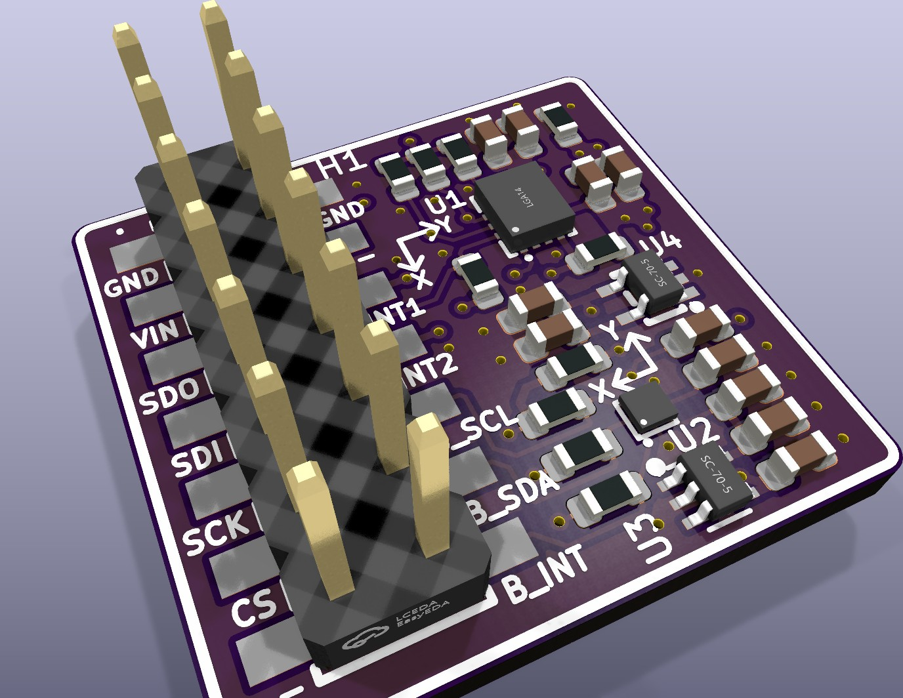
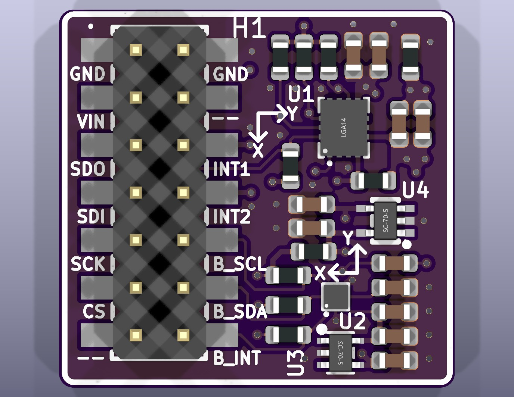

# Mechanical CAD

3D model of the SVX-IMU-ICM-BMM-001 9DoF sensor module (about 21 × 20 mm, 2 × 7 pin 2.54 mm header H1).
Verify the header position, sensor axes and clearances from the STEP model before designing a mount or enclosure.

- [Download STEP 3D CAD model](SVX_IMU_ICM_BMM_001.step?raw=true)
- [View CAD rendering (3D)](SVX_IMU_ICM_BMM_001_CAD_3D_View.jpg) · [View CAD rendering (top, H1 labels)](SVX_IMU_ICM_BMM_001_CAD_Top_View.jpg)

[← Product home](../README.md)
